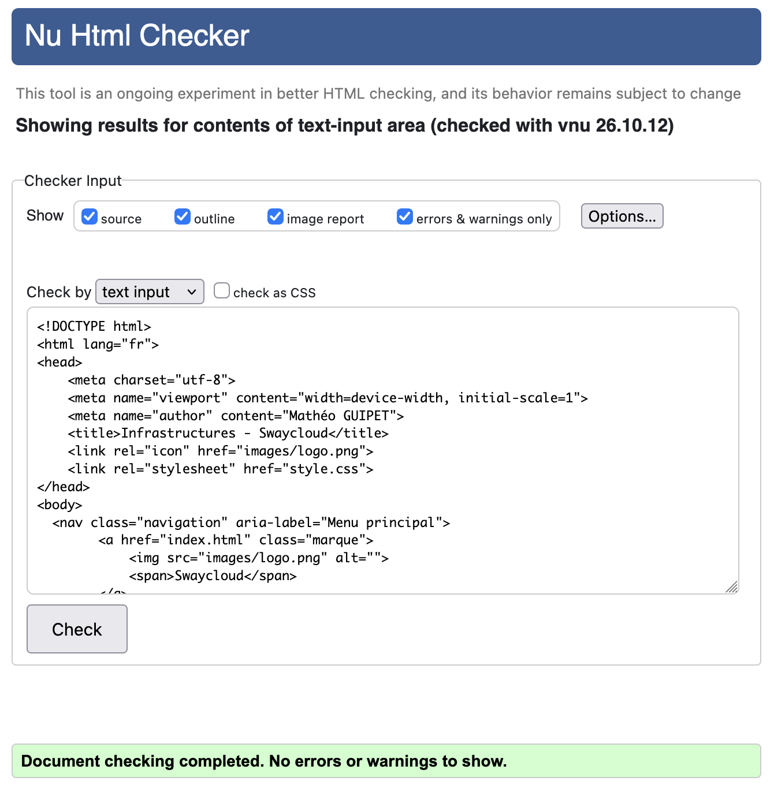
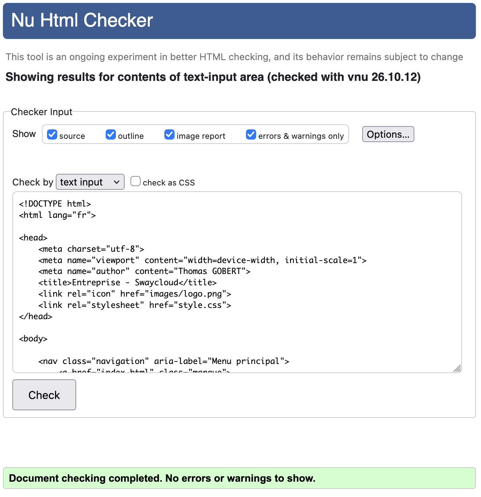
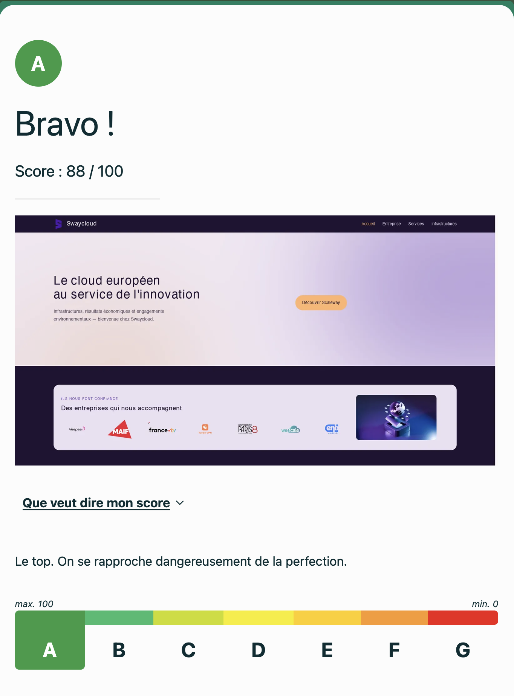
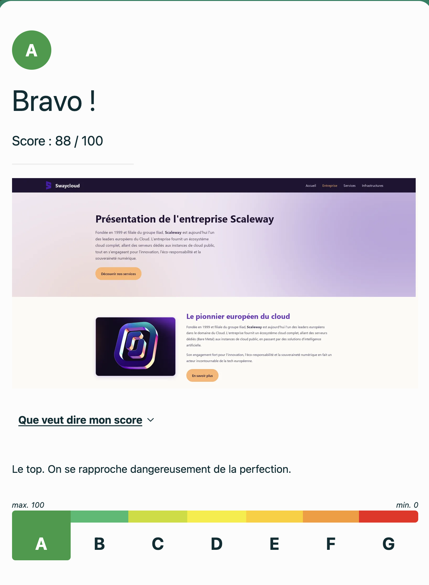
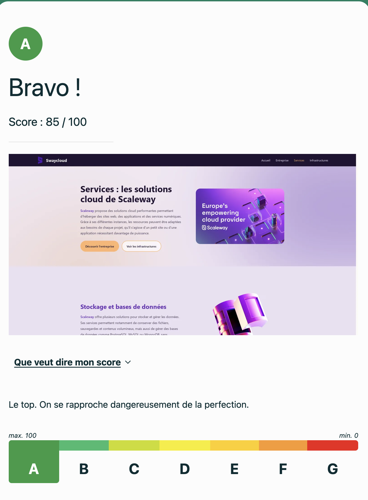
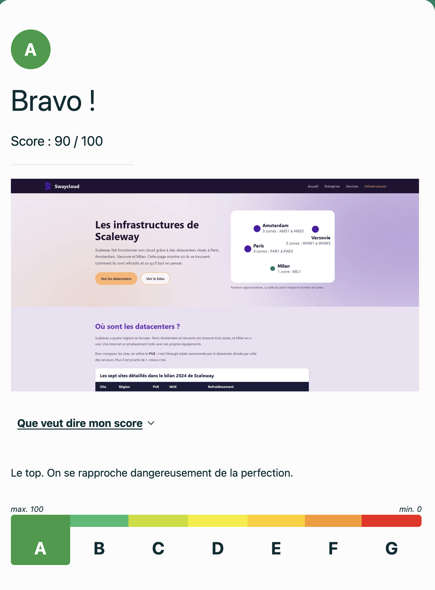

<h2>Nom du groupe</h2>
- groupe9_SAE05_06   
<h2>Membre du groupe</h2>
- Eline Iciakhene - référente  
- Matheo Guipet  
- Evann Guechi  
- Thomas Gobert  
<h2>Sujet</h2>
<a href="https://guechievann.github.io/groupe9_SAE05_06/" target="_blank" >Lien vers le site internet</a> 
<h2>Présentation du projet</h2>
Ce projet, consiste à présenter l'entreprise Scaleway sur différents aspects.
 
L'objectif est de faire découvrir cette entreprise à travers une présentation générale, 
 
mais également approfondie de son activité économique, des services qu'elle propose et de ses infrastructures.  

<h2>Répartition des tâches</h2>

<h3>Auteurs des pages</h3>

<ul>
    <li>Accueil : Eline Iciakhene </li>
    <li>Entreprise : Thomas Gobert</li>
    <li>Services : Evann Guechi</li>
    <li>Infrastructures : Mathéo Guipet </li>
</ul>

<h3>Autres tâches réalisées</h3>

<ul>
    <li>Recherches documentaires : Tout le monde </li>
    <li>Charte graphique et CSS : Mathéo Guipet</li>
    <li>Recherche des images : Tout le monde </li>
    <li>Tests et validation W3C : Eline iciakhene </li>
    <li>Rédaction du README : Thomas Gobert, Eline Iciakhene</li>
</ul>

## Tests de validation W3C

Les quatre pages HTML du site Scaleway ont été testées
et validées à l'aide du validateur officiel W3C.

### Page d'accueil

- Fichier : `index.html`
- Auteur : Eline Iciakhene
- Test réalisé par : Eline Iciakhene
- [Validation W3C - Accueil](https://validator.w3.org/nu/?doc=https%3A%2F%2Fguechievann.github.io%2Fgroupe9_SAE05_06%2Findex.html)

### Page Entreprise

- Fichier : `entreprise.html`
- Auteur : Thomas Gobert
- Test réalisé par : Eline Iciakhene
- [Validation W3C - Entreprise](https://validator.w3.org/nu/?doc=https%3A%2F%2Fguechievann.github.io%2Fgroupe9_SAE05_06%2Fentreprise.html)

### Page Services

- Fichier : `services.html`
- Auteur : Evann Guechi
- Test réalisé par : Eline Iciakhene
- [Validation W3C - Services](https://validator.w3.org/nu/?doc=https%3A%2F%2Fguechievann.github.io%2Fgroupe9_SAE05_06%2Fservices.html)

### Page Infrastructures

- Fichier : `infrastructures.html`
- Auteur : Mathéo Guipet
- Test réalisé par : Eline Iciakhene
- [Validation W3C - Infrastructures](https://validator.w3.org/nu/?doc=https%3A%2F%2Fguechievann.github.io%2Fgroupe9_SAE05_06%2Finfrastructures.html)

.
## Tests EcoIndex

Les quatre pages du site Scaleway ont été analysées
avec EcoIndex afin d'évaluer leur impact environnemental.

### Page d'accueil

### Page Entreprise

### Page Services

### Page Infrastructures

