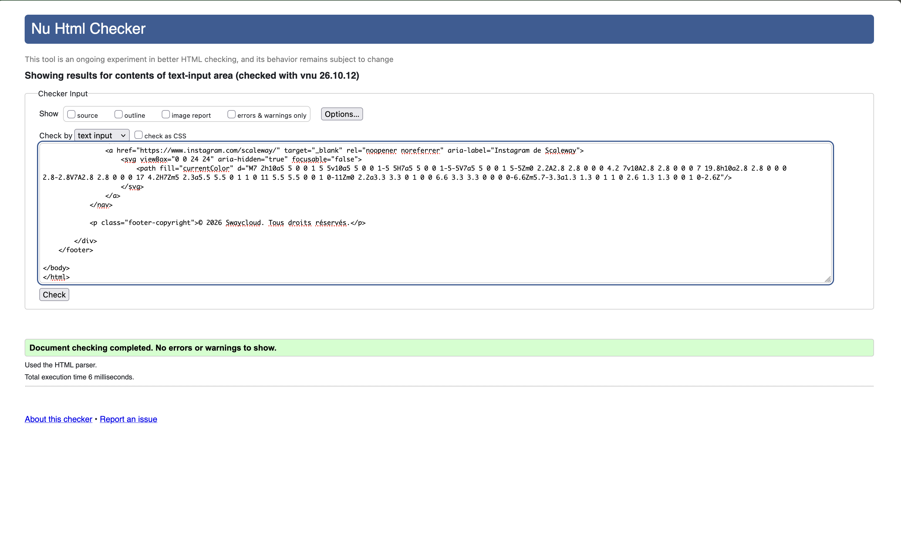
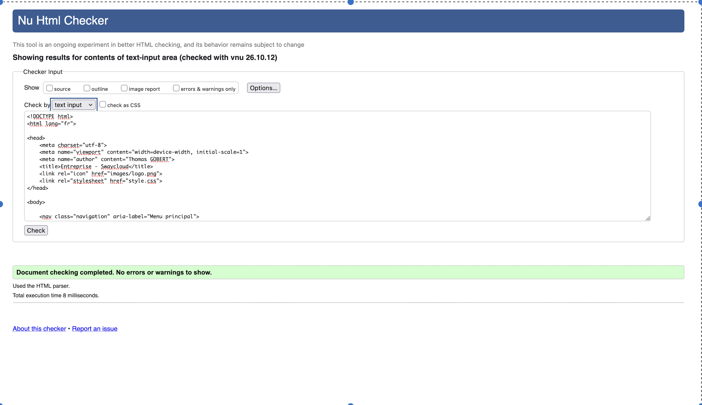
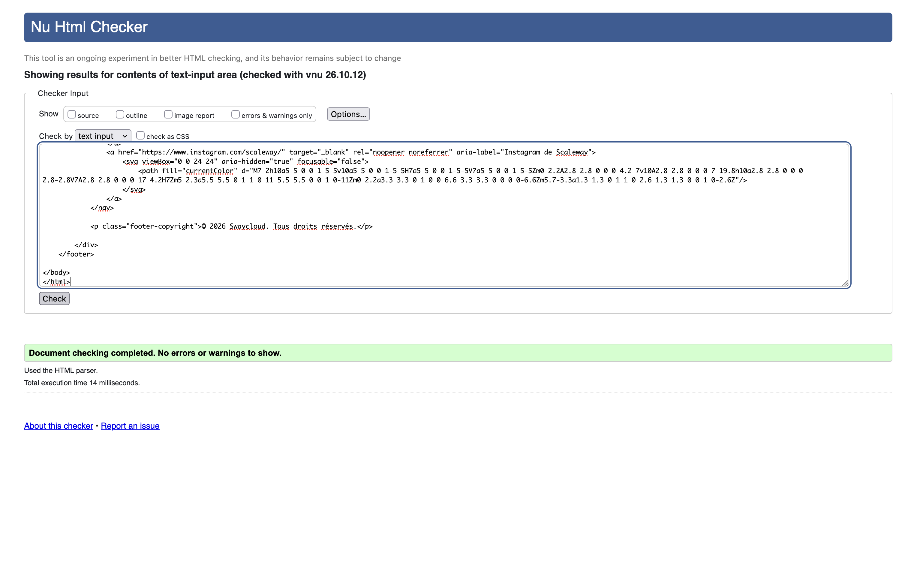
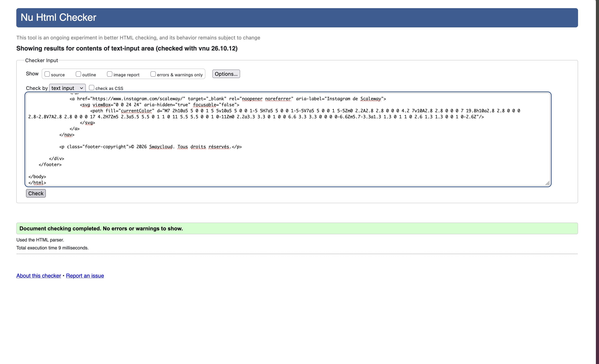

<h2>Nom du groupe</h2>
- groupe9_SAE05_06   
<h2>Membre du groupe</h2>
- Eline Iciakhene - référente  
- Matheo Guipet  
- Evann Guechi  
- Thomas Gobert  
<h2>Sujet</h2>
<a href="https://guechievann.github.io/groupe9_SAE05_06/" target="_blank" >Lien vers le site internet</a> 
<h2>Présentation du projet</h2>
Ce projet, consiste à présenter l'entreprise Scaleway sur différents aspects.
 
L'objectif est de faire découvrir cette entreprise à travers une présentation générale, 
 
mais également approfondie de son activité économique, des services qu'elle propose et de ses infrastructures.  

<h2>Validation W3C</h2>

<h3>Test 1</h3>

<h3>Test 2</h3>

<h3>Test 3</h3>

<h3>Test 4</h3>

